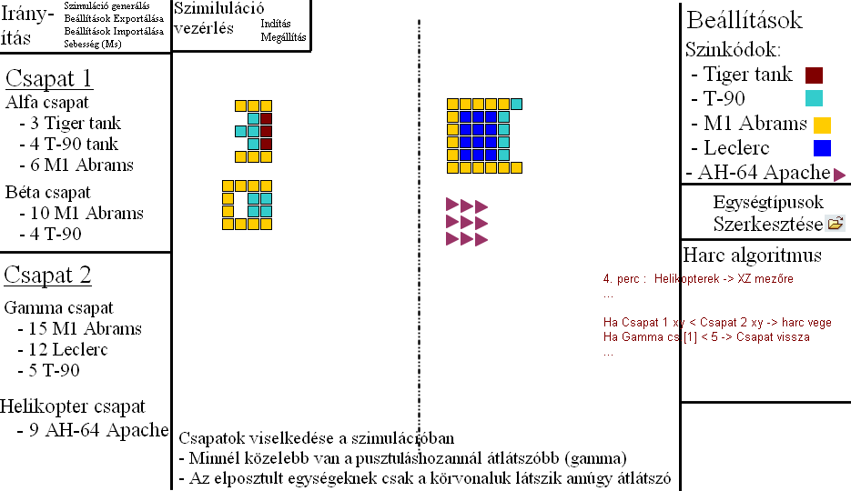

# 1. Projekt / Feladat áttekintése

A webes alkalmazás célja egy olyan hely megteremtése aminek segítségében egy jövőben tervezett RTS alapú játékhoz lehet
a benne lévő egységek statisztikáit megfelelően beállítani.

# 2. Jelenlegi helyzet

Egy játék fejlesztésénél kulcsfontosságú hogy kellemes és élvezetes játékélményt nyújtson. Ennek egyik alapköve, hogy
a játék minden eleme szinkronban legyen egymással egy nagy rendszert alkotva. A vízió szerint ez egy RTS alapú sand box játék
lenne melyet lehet coop módon csoportban vagy egyedül játszani ai ellenfelek közreműködésével. A játékkonceptcióból adódóan
a különböző egységek egy kulcsfontosságú pontja a játéknak, így fontos, hogy a hozzájuk tartalmazó statisztikák (úgy mint 
páncélzat, löveg, mobilitás, fejlesztési lehetőség és költség...) egyensúlyba legyen. Ennek bevett gyakorlata, hogy kezdetben
valamilyen magadott érték után a teszt játszások folyamán kialakulnak az ideális értékek. Ennek legynagyobb gondja, hogy ez lassú
és időigényes, illetve előfordulhat olyan eset ami nem kerül figyelembevételre. 

# 3. Vágyálom rendszer

A cél egy olyan platform megalkotása mely segítségével egyszerűen és nagy testreszabhatósággal lehet szimulálni a játékban lévő
csapatharcokat, vizsgálva miképpen viselkednek az adott egységtípusok egymás ellen. A rendszer egy Flask alapú webszolgáltatást
nyújtana melyen előre definiált lehetőségek igénybevételével lehet a játékban elérhető számú változatossággal egységeket összeállíani.
A rendszernek lehetőséget kell adnia különböző eseményeket is beiktatni szimuláció bizonyos szakaszaihoz vagy történések kiváltásakor.
A webes felület mindenki számára elérhető és nem tárol semmilyen információt a felhasználóról. Ha egy korábban összeálított szimulációt
szeretnénk újra szimulálni akkor az oldalnak lehetőséget kell adnia a jelenlegi felállást exportálhatóvá tenni melyet egy későbbi munkamenetbe
importálva lehet ugyanazt az összeálítást visszanyerni mint ami eredetileg volt. Továbbá fontos hogy mint ez előbbi beállítás export-import mint
a szerveren lévő egységstatisztikák tárolása könnyen szerkezthető Json adatszerkeztben legyen.

# 4. Funkcionális követelmények

Az oldal álltalános kinézete (Vágyálom) 4.1 ábra:

### Működési felépítés (kiens oldalról):
**Irányítás:**
- Szimuláció generálás: Gomb ami elküldi a szervernek a jelenleg beálított szimulációt paraméterezve. A kapott válasz alapján lehet lejátszani a szimulációt kliens oldalon.
- Beállítások Exportálása: Az oldalon lévő minden beállítás (kihelyezett csapatok, egységdefiníciók, Színkódok, Harc algoritmus) egy json fileként való letöltése.
- Beállítások Importálása: Az előbb json file beolvasása melyből visszaállítható az exportálásbéli állapot.
- Sebesség (Ms): Azt monjda meg hogy két "képkocka" között mennyi idő teljen le. Van egy valós idő amit a szerverver ad a szimuláció generálása után. 
Ezen lehet csökkententi: ekkor gyorsítjuk, illetve lehet növelni: ekkor lassítjuk a szimuláció lejétszását. A generálás módja a *Szerver oldali szimuláció generálás* részben olvasható.

**Szimuláció verzérlés:**
- Indítás: Elindítja a betöltött szimulációt. Csak akkor használható ha előtte a szerver legenerálta a beálítások alapján.
- Megállítás: Megállítja a futó szimulációt, amit aztán az *Indítás*-al lehet tovább nézni.

**Csapatok (Csapat 1, Csapat 2) kezelése:**

Felépítése Fa topológiára hasonlít.
A gyökérelem egy csapatnév (pl: Csapat \1). Ebből ágazik le egy vagy több csapat szintén nevesítve (pl: Alfa csapat, Béta csapat). Ezeken belül lehetnek a különböző egységtípusok.
A csapatnevek alá tartozó csapatok vizuálisan össecsukhatóak elrejtve a hozzájuk tartozó egységeket. 

Csapatok panelelen lehet továbbá meghatározni a különböző csapatok (Alfa, Béta) vizuális elrendezését is, vagyis hogy melyik egység pontosan hol áljon a csapatban (4.1 ábra).

**Színkódok:**

Ebben a részben vannak kilistázva a különböző egységtípusok és hozzájuk rendelt színek. A szimulációban ezzel a színnel lesznek jelölve az adott egységek. Itt csak megjelennek
a szinezési szabályok, de szerkezteni csak a *egységtípusok szerkeztése* menüben lehet.

**Egységtípusok szerkeztése:**

Az itt lévő gomb egy szerkeztő panelre visz át ahol lehet szerkezteni az adott egység különböző tulajdonságait. Ezek a tulajdonságok a következőképpen néznek ki:

#### Fejlesztési komponensek tulajdonságai:
- Löveg
  - páncélátütési jellemzők
  - tömeg
  - kaliber
  - tüzelési sebesség
  - csőhossz: befolyásolja a pontosságot és a hatótávot
  - használható légvédelemhez (bool)
- Páncélzat
  - páncél típusa (pl: homogén acél, felületkeményített homogén acél, öntött homogén acél, szendvics páncél)
  - páncél osztály (1-6) ahol a \6 a legnehezebben átüthető
  - elhelyzkedés (homlok, torony, oldal, hát, tető) a harckocsin
  - tömeg
  - döntött-e (tető páncélnál nem lehet döntött)
  - sérülés mértéke (0-100%)
- Lőszerraktár (tárolhat: Harckocsi lövedékeket, rakétákat, egyéb harckocsi álltal használt eszközöket)
  - méret (egység)
  - tömeg (üresen)
  - sérülés mértéke (0-100%)
- Erőforrás (motor)
  - alap fogyasztás
  - tömeg
  - teljesítmény (lóerő)
  - sérülés mértéke (0-100%)
- Lánctalp
  - maximális terhetőség: ha a harckocsi tömege ezt átlépi akkor az adott lánctalpat nem használhatja
  - maximális átvihető teljesítmény: maximum ennyi lőerőnyi teljesítményt tud fogadni a motortól. Ha ezt meghaladja akkor nem használható azzal a motorral
  - gördülési átmérő: minél nagyobb annál nagyobb sebesség érhető el
  - sérülés mértéke (0-100%)

#### Egységtípusok tulajdonságai:
- Harckocsik és földi járművek esetében
  - löveg (komponens)
  - légvédelmi löveg: csak olyan löveg komponens kerülhet ide ami *használható légvédelemhez*.
  - páncélzat (komponens)
    1. homlok páncél
	2. torony páncélzat
    2. oldal páncél
    3. hát páncél
    4. tető páncél
  - lőszerraktár (komponens)
  - erőforrás (komponens)
  - lánctalp (komponens)
  - maximális sebesség (számított: tömeg + erőforrás + lánctalp alapján)
  - össztömeg (számított: komponensek tömege + jármű alap tömege)
  - irányításhoz szükséges legénység száma
  - elpusztult-e (bool)

**Szerver oldali szimuláció generálás:**
< - kifejtést igényel

**Harc algoritmus:**

Itt több dolgot is meg kell határozni:
- csapaton belüli egységtípusok támadási priolitása: azt határozza meg, hogy az adott csapatokon belüli egységek mit és milyen sorrendben támadjon.
- Harc közbeni események:
  - Ha xy egység/csapat < xy egység/csapat akkor mi történjen pl mozogjon máshová vagy vonoljun vissza, módosítson priolitási sorrendet
  - Ha x idő eltelt akkor mi történjen

**Középső szimulációs tér:**

Itt kerül lejátszásra a szerver álltal visszaadott szimuláció. A lejátszási sebesség az *Irányítás sebesség* beálított értékétől függ. A szimulációban lévő 
csapatok felépítését és elhelyezkedésénak logikai reprezentációját szemlélteti. Ez alapján pontosan meg lehet mondani melyik csapatban milyen 
típusú (földi járművek négyzet, helikopterek háromszög szinezett jel) illetve hogy melyikfélhez tartozik. A szinezés átlátszóságából pedig lehet következtetni
az adott egység sérüléseire is (minnél rosszabb álapotban van annál inkább átlátszó), ha elpusztult akkor pedig csak a körvonala marad. 
Az adott egységre való kattintáskor egy kis menüben olvasható az adott egység jelenelegi tulajdonságai

# 5. Rendszerre vonatkozó törvények, szabványok

- Adatszerkezetek és interoperabilitás
  - JSON szabvány (RFC 8259): minden exportált és importált beállítás JSON formátumban legyen, így biztosítva az adatok könnyű szerkeszthetőségét és platformfüggetlenségét.
  - UTF-8 karakterkódolás: a nemzetközi kompatibilitás és a speciális karakterek kezelése miatt.
- Webes szabványok
  - HTML5 / CSS3 / JS ES6+: kliens oldali felület fejlesztéséhez.
  - Flask (Python webframework): szerveroldali API és szimulációs logika implementálásához.
  - REST API szabvány: szimuláció indítása, adatok export-import kezelése.
- Biztonsági és etikai szabványok
  - No user data collection: az oldal nem tárol személyes adatot, GDPR kompatibilis működés.
  - Content safety: minden szimulált tartalom biztonságos, nem tartalmaz malware-t vagy külső linkeket.
  - Accessibility (WCAG 2.1): a felhasználói felület legyen elérhető és olvasható minden felhasználó számára (színkontraszt, olvashatóság).
- Játékmenet és egységek
  - Egység- és komponens integritás: a felhasználó nem állíthat be fizikailag lehetetlen értékeket (pl. negatív tömeg, túl nagy sebesség).
  - Konzisztencia szabályok: lánctalp és motor teljesítményének összhangja, páncél és tömeg arányának ésszerűsége.

# 6. Jelenlegi üzleti folyamatok modellje

Játékszoftver felhasználói:
- játékosok

Játékszoftver fejlesztői:
- vezető fejlesztő
- irodavezető
- egyéni fejlesztő
- belső játékszoftver tesztelők
- kapcsolattartó (fejlesztői)

Forgalmazó / Kiadó:
- kapcsolattartó (kiadói)
- viszajelzéseket kezelő menedzser

Jelelegi üzleti (fejlesztési) folyamat:
> Új játékelem elkészítése (játékos kezdeményezésre): játékosokban felmerül egy igény egy lehetséges fejlesztési ötletre (például újfata vadászgép) =>
ez az igény eljut a viszajelzéseket kezelő menedzserhez => az igény továbítódik a kiadói kapcsolattartóhoz => majd továbbítják a fejlesztői kapcsolattartóhoz =>
majd a vezető fejlesztőhöz => vezető fejlesztő megviszgálja és elbírálja és felosztja kisebb munkafolyamatokra => a részegységek továbbítódnak az
irodavezetőkhöz => az irdavezetők pedig kiosztjátk az egyes fejlesztőknek a személyes feladatokat => amikor kész a fejlesztés továbbítódik a belső tesztelőknek =>
ekkor kerül véglegesítésre az újítás játék egészébe illeszkedő adatok véglegesítése => házon belül tesztelt újjítást egy frissítés formályában kiadják a játékosoknak =>
a játékosok visszajelzést adnak a frissítésről => ez eljut a kiadóhoz majd a ciklus előről kezdődik csak most egy javítási igénnyel.

# 7. Igényelt üzleti folyamatok modellje

Szimulátor szoftver fejlesztői:
- szerver oldali beállítások kezelője

Itt a cél az lenne hogy ne keljen a hosszadalmas körökön végigmenni az adott újítás egymás utáni balace javításai miatt.
Ideális modell:
> Egy új tartalom sorozatos balance változtatások helyett: házon belül a tesztelők szimulálják hogy viselkedik a játék egyensúlyában az adott új tartalmom =>
a módosítási javaslataikat továbbítják a szerver oldali beállítások kezelőjéhez => elbírálás után végrehajtaj a módosításokat => a módosítások után ismételt szimulációkkal 
elérhető egy megfelelő egyensúly => elfogadás után a frissítés publikálásra kerül ami tetszeni fog a játékosoknak elsőre a szimulációs webszolgáltatásnak köszönhetően.

# 8. Követelménylista

ID|Verzió|Név|Kifejtés|
--|------|---|--------
K01|V1.0|Szimuláció generálás API|A kliens képes elküldeni a jelenlegi beállításokat a szervernek, a szerver validálja és determinisztikusan legenerál egy szimulációs állapotot (time-step adatok sorozata)
K02|V1.0|Szimuláció lejátszó / vezérlő|A kliens betöltheti a szerver által generált szimulációt, tudja lejátszani, megállítani, léptetni és sebességet változtatni
K03|V1.0|Export / Import JSON állapot|A felhasználó mindent (csapatfelállás, egységtípusok, színkódok, harc-algoritmus) egy JSON fájlként letölthet, illetve feltölthet ezzel azonos formátumú fájlt, amely rekonstruálja az állapotot
K04|V1.0|Egység- és komponens szerkesztő (UI)|Felület a komponensek (löveg, páncél, lánctalp, motor, lőszerraktár) és egységtípusok szerkesztésére, a komponensekhez tartozó mezők szerkeszthetők
K05|V1.0|Fa-topológia alapú csapatkezelés|Csapatok hierarchikus (fa) felépítése, csapatok kibontható/összecsukható listája; csapaton belüli pozíciók szerkeszthetők
K06|V1.0|Szimuláció eseménykezelés / trigger rendszer (szerveroldalon)|A felhasználó beállíthat egyszerű eseményeket/triggert (pl. „ha X egység HP < Y akkor visszavonulás”), melyek a szervergenerált szimulációban érvényesülnek
K07|V1.0|Egységek vizuális jelölése és állapot megjelenítés|A szimulációs tér megjeleníti az egységeket alakzattal és színnel; átlátszóság tükrözi a sérülést; kattintással részletes infópanel nyílik|
K08|V1.0|Adat- és séma-validáció szerveroldalon|Minden import/klienstől érkező JSON a szerveroldalon JSON-sémával validált; hibás adat nem generál szimulációt
K09|V1.0|Biztonság és adatvédelmi szabályok betartása|A webszolgáltatás nem tárol személyes adatot; CORS/CSP beállítások megfelelőek; GDPR-kompatibilitás
K10|V1.0|Dokumentáció és sorozatos tesztelés|Fejlesztői és felhasználói dokumentáció

# 9. \-

# 10. Fogalomtár

**RTS (Real-Time Strategy)**
Valós idejű stratégiai játék műfaj: a játékosok egységeket és épületeket irányítanak valós időben (nem körökre osztva). A szimulátor célja az RTS jellegű harci egyensúly modellezése.

**Sand Box**
Olyan játékmód vagy játék, ahol nincs lineáris cél vagy erősen korlátozott folyamat — a játékos szabadságát és kísérletezhetőségét támogatja. A szimulátor szerkeszthető sandbox beállításokat biztosít a teszteléshez.

**balance**
A játék egyensúlya: az egységek és mechanikák olyan beállítása, ami biztosítja, hogy nincs túlzottan erős vagy gyenge opció, és a játék élvezetes, taktikai döntésekre épül. A szimulátor ezt segíti optimalizálni automatizált tesztekkel.

**Json adatszerkezet**
A platform adatcseréjének formátuma: könnyen olvasható, szerkeszthető, platformfüggetlen. A projektben minden konfiguráció és export JSON formátumú lesz, sémával validálva.

**exportálhatóság / importálhatóság**
Az az elv, hogy a felhasználó által konfigurált állapotot (csapatok, egységek, események) JSON fájlként le lehet tölteni (export), és ugyanaz a fájl visszatölthető (import) a pontos reprodukálás érdekében.

**Flask**
Python alapú mikro-webframework, amely a szerveroldali API és a szimulációs generátor implementációjára ajánlott (könnyű, jól integrálható). A dokumentumban a Flask a backend referenciaimplementációjára utal.

**Löveg (komponens)****
Az egység tűzfegyvere: jellemzői közé tartozik a páncélátütés, tömeg, kaliber, tüzelési sebesség, csőhossz és az a flag, hogy használható-e légvédelemhez. A löveg és a hozzá tartozó lőszer határozza meg az egység tűzerő- és hatótáv-paramétereit.

**Páncélzat (komponens)**
A jármű különböző zónáin elhelyezett védelem, típusokkal (homogén, szendvics, felületkeményített stb.), osztályokkal (1–6) és pozíciókkal (homlok, torony, oldal, hát, tető). A páncél határozza meg az ellenállást különböző fegyverek ellen.

**Lánctalp (komponens)**
A jármű talpalata: terhelhetőség, maximális átvihető teljesítmény és gördülési átmérő alapján korlátozza, milyen össztömeg és motorteljesítmény kompatibilis a járművel, befolyásolja a mozgási képességeket.

**Erőforrás / motor (komponens)**
A hajtás egysége: teljesítmény (lóerő), tömeg és fogyasztás határozza meg a power-to-weight arányt, gyorsulást, üzemanyag-fogyasztást és a maximális sebességet.

**Lőszerraktár (komponens)**
Az egység belső tárolótere lőszer számára: méret és tömeg határozza meg, mennyi lőszer vihető; sérülés esetén robbanásveszély (kritikus találat) áll fenn.

**Maximális sebesség (számított mező)**
A jármű elméleti legnagyobb sebessége, amelyet a komponensekből számolunk (össztömeg, motor teljesítmény, lánctalp karakterisztika). A játékban tereptípusok és sérülések módosíthatják.

**Össztömeg (számított mező)**
Minden komponens tömegéből és a jármű alap tömegéből számított teljes tömeg. Fontos a lánctalp kompatibilitás, fogyasztás és mozgás szempontjából.

**Deterministic simulation**
Determinista szimuláció: ugyanazokkal a bemeneti paraméterekkel, seed-del mindig ugyanazt az eredményt kapjuk. Kritikus a reprodukálhatósághoz és a tesztelés automatizálásához.

**Harc algoritmus**
A csapatok viselkedését vezérlő szabályrendszer: célprioritások, trigger-alapú események (pl. visszavonulás feltételei), újraprioritások. A szimulátorban konfigurálható és tesztelhető.

**Csapatfa (fa-topológia)**
A csapatok hierarchikus szervezése: root (csapatcsoport) → alcsoportok → egységtípusok. A UI a fa alapján jeleníti meg és kezeli a csapatokat.